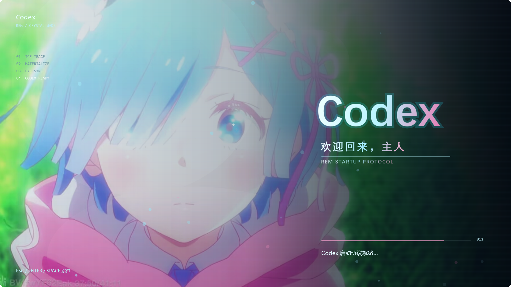

# 雷姆 Codex 启动动画

这是一个 Windows EXE 版 Codex 启动动画。双击 `Start-Codex-Rem.exe` 会播放 8.4 秒的雷姆主题片头，片头结束后打开 Codex。按 `Esc`、`Enter` 或空格可以跳过动画并打开 Codex。



## 使用

- `Start-Codex-Rem.exe`：播放片头并打开 Codex
- `Start-Codex-Rem.cmd`：同上，方便创建快捷方式
- `Preview-Rem.cmd`：只预览动画，不打开 Codex

请保留同目录的 `launcher.config.xml` 和 `assets/rem-reference.jpg`。

## 配置

打开 `launcher.config.xml` 可以修改：

- `durationSeconds`：动画时长
- `frameRate`：逐帧导出帧率
- `referenceImage`：参考图路径
- `appUserModelId`：Codex 的 Windows 应用标识
- `executablePath` / `executableArguments`：如果不用 MSIX 标识，可改成普通桌面程序路径

## 重新编译

```powershell
powershell -NoProfile -ExecutionPolicy Bypass -File .\build.ps1
```

## 导出帧序列或视频

首次使用先安装项目内的便携 FFmpeg：

```powershell
powershell -NoProfile -ExecutionPolicy Bypass -File .\install-ffmpeg.ps1
```

然后直接导出 1080p / 60fps MP4：

```powershell
powershell -NoProfile -ExecutionPolicy Bypass -File .\render-preview.ps1
```

导出过程会把 WPF 画面直接传给 FFmpeg，不会留下庞大的临时帧目录。EXE 本身不依赖 FFmpeg，可以直接播放动画。

## 说明

参考图来自你提供的本地图片，项目仅用于本机个人启动动画。开场从纯暗场开始，依次经过冰晶描边、粒子聚合、人物显形、瞳孔追光、头发和肩部轻动、极光背景、Codex 标题聚合与收束退场。
